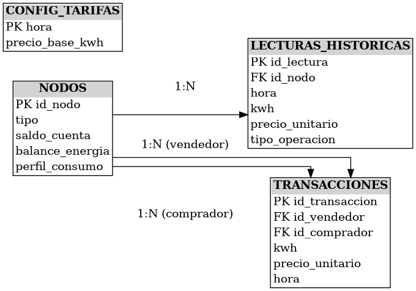

# Algoritmo de Subasta Doble Continua y Modelo Transaccional

Este documento explica en detalle los fundamentos matemáticos, algorítmicos y transaccionales del motor de matching y persistencia de **EcoGrid**.

---

## 1. El Mecanismo de Mercado: Subasta Doble Continua (*Continuous Double Auction - CDA*)

En los mercados financieros y de materias primas (como NASDAQ, NYSE o los mercados eléctricos mayoristas como OMIE en Europa y PJM en EE.UU.), el mecanismo por excelencia para fijar precios de manera descentralizada y eficiente es la **Subasta Doble Continua**.

A diferencia de una subasta simple (donde un solo vendedor recibe ofertas de múltiples compradores, o viceversa), en una **subasta doble** existen simultáneamente:
* **Múltiples compradores (*Bidders*):** Cada uno declara cuántos kWh necesita y cuál es el **precio máximo** que está dispuesto a pagar.
* **Múltiples vendedores (*Askers*):** Cada uno declara cuántos kWh ofrece y cuál es el **precio mínimo** que está dispuesto a recibir.

---

## 2. Estructuras de Datos y Prioridad Precio-Tiempo

Para garantizar equidad y alto rendimiento, el libro de órdenes (*Order Book*) implementa la regla estándar de la industria: **Prioridad Precio-Tiempo (*Price-Time Priority*)**:
1. **Prioridad por Precio:** Siempre se despacha primero al comprador dispuesto a pagar más y al vendedor dispuesto a cobrar menos.
2. **Prioridad por Tiempo:** Entre dos órdenes al mismo nivel de precio, se ejecuta primero la que ingresó antes (orden FIFO).

### Implementación en C++17

```cpp
// Libro de Compras: Ordenado de mayor a menor precio
using BidMap = std::map<double, std::queue<Orden>, std::greater<double>>;

// Libro de Ventas: Ordenado de menor a mayor precio (orden por defecto)
using AskMap = std::map<double, std::queue<Orden>>;
```

```
                     LIBRO DE ÓRDENES (ORDER BOOK)

          BID MAP (COMPRAS)                     ASK MAP (VENTAS)
      std::greater<double>                   std::less<double>
      
  Precio ($)        Cola FIFO             Precio ($)        Cola FIFO
 ┌──────────┬────────────────────────┐   ┌──────────┬────────────────────────┐
 │  $ 2.50  │ [Ord#3] ──> [Ord#7]    │   │  $ 1.10  │ [Ord#1] ──> [Ord#4]    │ ◄── Mejor Ask (begin)
 ├──────────┼────────────────────────┤   ├──────────┼────────────────────────┤
 │  $ 2.20  │ [Ord#5]                │   │  $ 1.40  │ [Ord#9]                │
 ├──────────┼────────────────────────┤   ├──────────┼────────────────────────┤
 │  $ 1.80  │ [Ord#2] ──> [Ord#8]    │   │  $ 1.90  │ [Ord#6]                │
 └──────────┴────────────────────────┘   └──────────┴────────────────────────┘
       ▲
       └──── Mejor Bid (begin)
```

### Análisis de Complejidad Algorítmica

| Operación | Estructura Utilizada | Complejidad Temporal | Justificación |
| :--- | :--- | :--- | :--- |
| **Inserción de Orden** | `std::map::operator[]` + `std::queue::push` | $O(\log K)$ | Inserción en árbol rojinegro balanceado de $K$ niveles de precio distintos. |
| **Consulta del Mejor Cruce** | `map::begin()` | $O(1)$ | La mejor oferta siempre se ubica en la raíz o extremo del árbol. |
| **Extracción FIFO** | `std::queue::front` / `pop` | $O(1)$ | Operación en tiempo constante sobre la cola del nivel de precio. |
| **Matching Global del Tick** | Bucle `while(!bidMap.empty() && !askMap.empty())` | $O(M \log K)$ | Donde $M$ es la cantidad de transacciones ejecutadas en el tick. |

---

## 3. Algoritmo de Matching y Formación de Precios

En cada iteración del bucle principal de [GridManager::procesarTick()](file:///home/agusfacch/Documents/aus/doo/tpFinal/EcoGrid/src/business/GridManager.cpp):

1. **Evaluación del Spread:**
   Se compara la mejor oferta de compra ($P_{\text{bid}}$) con la mejor oferta de venta ($P_{\text{ask}}$):
   $$\text{Spread} = P_{\text{bid}} - P_{\text{ask}}$$
   * Si $\text{Spread} \ge 0$, existe compatibilidad económica y se procede al cruce.
   * Si $\text{Spread} < 0$, no hay compradores dispuestos a pagar lo que piden los vendedores; el matching de mercado finaliza.

2. **Cálculo del Precio de Clearing (*Fair Mid-Price*):**
   El precio de la transacción se determina como el punto medio entre ambas pretensiones:
   $$P_{\text{clearing}} = \frac{P_{\text{bid}} + P_{\text{ask}}}{2.0}$$
   Este mecanismo garantiza que tanto comprador como vendedor obtengan un excedente económico (*surplus*): el comprador paga menos de lo que estaba dispuesto a pagar y el vendedor cobra más de lo que pedía.

3. **Determinación del Volumen y Ejecución Parcial:**
   La cantidad de energía transaccionada corresponde al mínimo entre la demanda de compra y la oferta de venta:
   $$\text{Energía} = \min(Q_{\text{compra}}, Q_{\text{venta}})$$
   * La orden menor queda completamente satisfecha y se elimina de la cola.
   * La orden mayor se actualiza: $Q_{\text{remanente}} = Q - \text{Energía}$. Si $Q_{\text{remanente}} > 0.001\text{ kWh}$, vuelve a la cola en su mismo nivel de precio conservando su orden de llegada.

---

## 4. Ciclo Físico de la Batería Comunitaria (*Storage Node*)

El `NodoAlmacenamiento` cumple una función dual como estabilizador físico y financiero de la micro-red:

```
                      FLUJO DEL TICK EN LA BATERÍA
                      
Inicio del Tick (Hora H)
  │
  ├─► ¿Tiene carga acumulada? (bateria.getCargaActual() > 0)
  │     ├── SÍ: Inyecta orden de VENTA en askMap al Precio Base Horario
  │     └── NO: Continúa sin oferta inicial
  │
Ejecución del Matching de Mercado
  │
  ├─► Si un consumidor compra energía ofertada por la batería:
  │     └── Se descuenta la carga física entregada: bateria.liberarEnergia(kWh)
  │
Fin del Matching de Mercado (Spread < 0)
  │
  └─► Liquidación de Excedentes (Buyer of Last Resort)
        ├── Se recorren las órdenes de venta remanentes en askMap
        ├── Si la orden pertenece a un Prosumidor:
        │     ├── Batería absorbe la energía: bateria.absorberEnergia(kWh)
        │     └── Se crea TransaccionEnergia (Vendedor: Prosumidor, Comprador: Batería, Precio: Base)
        └── Si la orden pertenece a la propia Batería:
              └── Se descarta sin auto-comprar (mantiene su remanente para el siguiente tick)
```

---

## 5. Modelo Transaccional y Consistencia ACID

Para evitar inconsistencias financieras o de balance energético, EcoGrid separa estrictamente el cómputo en memoria de la consolidación en disco:

### 5.1. Transaccionalidad a Dos Fases (*Two-Phase Flow*)
1. **Fase 1: Simulación en RAM (Libre de Side-Effects):**
   El algoritmo de matching calcula todas las transacciones del tick, valida remanentes y liquida con la batería en memoria. Si ocurre una excepción aquí, la base de datos ni siquiera fue tocada.
2. **Fase 2: Persistencia Atómica (*Batch Commit*):**
   El vector completo `std::vector<TransaccionEnergia>` se persiste en PostgreSQL dentro de un único bloque transaccional:
   ```cpp
   soci::transaction tr(this->sql);
   try {
       for (const auto& t : transacciones) {
           this->insertarTransaccion(t);
           this->actualizarSaldoYLecturas(t.idVendedor, t.kwh, t.precio, "venta", t.hora);
           this->actualizarSaldoYLecturas(t.idComprador, t.kwh, t.precio, "compra", t.hora);
       }
       tr.commit(); // Confirmación única atómica
   } catch (...) {
       // Rollback automático por RAII
       throw;
   }
   ```

### 5.2. Reglas de Integridad del Lado del Servidor (PostgreSQL)

El esquema [sql/schema.sql](file:///home/agusfacch/Documents/aus/doo/tpFinal/EcoGrid/sql/schema.sql) implementa salvaguardas directas en el motor de base de datos:

#### Trigger Defensivo de Solvencia: `trg_validar_saldo`
Antes de insertar cualquier fila en la tabla `transacciones`, un trigger `BEFORE INSERT` verifica en tiempo real que el comprador posea saldo de créditos suficiente:
```sql
CREATE OR REPLACE FUNCTION validar_saldo_comprador()
RETURNS TRIGGER AS $$
DECLARE
    v_saldo NUMERIC(15,2);
BEGIN
    SELECT saldo_cuenta INTO v_saldo FROM nodos WHERE id_nodo = NEW.id_comprador;
    IF v_saldo < (NEW.kwh * NEW.precio_unitario) THEN
        RAISE EXCEPTION 'Saldo insuficiente para realizar la compra (Nodo ID: %)', NEW.id_comprador;
    END IF;
    RETURN NEW;
END;
$$ LANGUAGE plpgsql;
```
Si el comprador no puede cubrir la operación, PostgreSQL aborta la transacción con una excepción, disparando el `ROLLBACK` en C++ y preservando la integridad del libro mayor.

#### Procedimiento Almacenado de Liquidación y Auditoría: `actualizar_saldo_y_lecturas`
Se encarga de actualizar de manera atómica el saldo contable y el balance de kWh del nodo, registrando simultáneamente una fila inmutable en la tabla de auditoría `lecturas_historicas`:
```sql
CREATE OR REPLACE PROCEDURE actualizar_saldo_y_lecturas(
    p_id_nodo INTEGER,
    p_kwh NUMERIC,
    p_precio NUMERIC,
    p_tipo_operacion VARCHAR(10),
    p_hora SMALLINT
)
LANGUAGE plpgsql AS $$
DECLARE
    v_importe NUMERIC := p_kwh * p_precio;
BEGIN
    IF p_tipo_operacion = 'venta' THEN
        UPDATE nodos
        SET saldo_cuenta = saldo_cuenta + v_importe,
            balance_energia = balance_energia - p_kwh
        WHERE id_nodo = p_id_nodo;
    ELSE
        UPDATE nodos
        SET saldo_cuenta = saldo_cuenta - v_importe,
            balance_energia = balance_energia + p_kwh
        WHERE id_nodo = p_id_nodo;
    END IF;

    -- Auditoría histórica del tick
    INSERT INTO lecturas_historicas(id_nodo, hora, kwh, precio_unitario, tipo_operacion)
    VALUES (p_id_nodo, p_hora, p_kwh, p_precio, p_tipo_operacion);
END;
$$;
```

---

## 6. Diagrama Entidad-Relación de la Base de Datos

El diseño del modelo relacional normalizado se ilustra a continuación:


