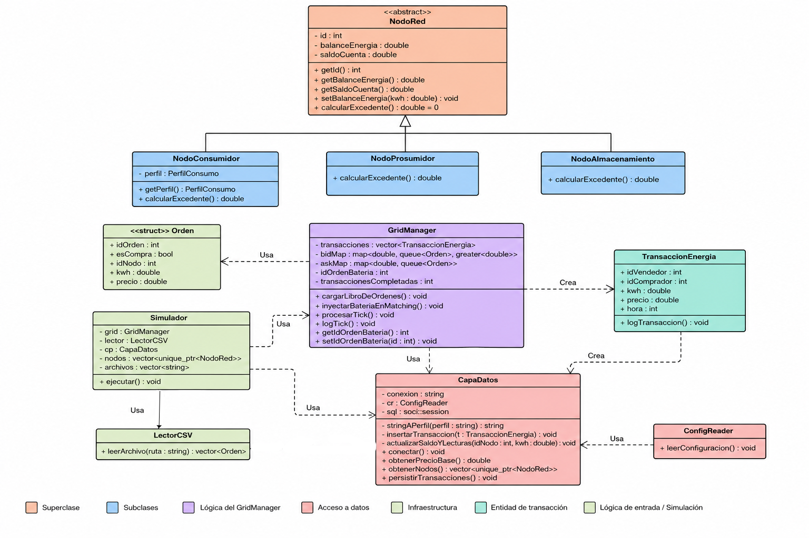

# Patrones de Diseño y Decisiones de Arquitectura en EcoGrid

Este documento profundiza en la arquitectura de software, los patrones de diseño orientados a objetos y las decisiones técnicas de ingeniería aplicadas en el proyecto **EcoGrid**.

---

## 1. Arquitectura en Capas (*Layered Architecture*)

El sistema se estructura en capas con responsabilidades delimitadas y dependencias unidireccionales para maximizar el desacoplamiento, la testeabilidad y la mantenibilidad:

```
┌────────────────────────────────────────────────────────┐
│             Capa de Simulación / Orquestación          │
│                      (Simulador, main)                 │
└───────────────────────────┬────────────────────────────┘
                            │
        ┌───────────────────┴───────────────────┐
        ▼                                       ▼
┌───────────────────────────────┐ ┌───────────────────────────────┐
│     Capa de Lógica de Negocio │ │        Capa de Entrada        │
│          (GridManager)        │ │          (LectorCSV)          │
└───────────────┬───────────────┘ └───────────────────────────────┘
                │
                ▼
┌────────────────────────────────────────────────────────┐
│             Capa de Dominio y Entidades                │
│    (NodoRed, NodoConsumidor, NodoProsumidor, etc.)     │
└───────────────────────────┬────────────────────────────┘
                            │
                            ▼
┌────────────────────────────────────────────────────────┐
│         Capa de Persistencia y Acceso a Datos          │
│               (CapaDatos, ConfigReader)                │
└────────────────────────────────────────────────────────┘
```

### Separación de Responsabilidades por Capa

1. **Capa de Dominio (`src/model/`):**
   * Modela los conceptos nucleares de la micro-red eléctrica.
   * Totalmente agnóstica a la infraestructura: no conoce de bases de datos, archivos CSV ni interfaces de consola.
   * Contiene la jerarquía polimórfica de nodos (`NodoRed`) y las estructuras de intercambio de datos (`Orden`, `TransaccionEnergia`).

2. **Capa de Negocio y Algoritmia (`src/business/`):**
   * **`GridManager`:** Implementa las reglas del mercado energético (libro de órdenes, subasta doble continua, liquidación de batería). Opera completamente en memoria RAM sin llamadas directas a disco ni sockets durante el matching.
   * **`Simulador`:** Orquesta la secuencia discreta de tiempo (*ticks* horarios), sincronizando la carga de órdenes, la ejecución del matching y la persistencia atómica.
   * **`LectorCSV`:** Módulo especializado en la ingesta, sanitización y validación de ofertas provenientes del sistema de archivos.

3. **Capa de Persistencia (`src/database/`):**
   * Encapsula la comunicación con el motor de base de datos PostgreSQL utilizando la librería SOCI.
   * Mapea registros relacionales a instancias polimórficas del modelo de dominio.
   * Gestiona el ciclo de vida de las transacciones SQL (`BEGIN`, `COMMIT`, `ROLLBACK`).

---

## 2. Patrones de Diseño Implementados

### 2.1. Patrón RAII (*Resource Acquisition Is Initialization*)
En C++ moderno, la gestión manual de memoria y recursos (`new`/`delete`, `malloc`/`free`, `fopen`/`fclose`) es una fuente clásica de fugas de memoria (*memory leaks*), punteros colgantes (*dangling pointers*) y bloqueos de conexión. EcoGrid aplica el principio **RAII** de forma estricta:

* **Gestión de Memoria Dinámica (`std::unique_ptr`):**
  Los nodos de la red son heterogéneos y polimórficos. Se gestionan a través de contenedores de punteros inteligentes:
  ```cpp
  std::vector<std::unique_ptr<NodoRed>> nodos;
  ```
  La propiedad es unívoca. Cuando el vector sale de ámbito, todos los nodos son destruidos automáticamente llamando a sus destructores virtuales correspondientes.
* **Transaccionalidad RAII con SOCI:**
  El manejo de transacciones en base de datos utiliza `soci::transaction`:
  ```cpp
  soci::transaction tr(this->sql);
  try {
      // Inserciones y llamadas a Stored Procedures
      tr.commit(); // Solo se consolida si no hubo excepciones
  } catch(const std::exception& e) {
      // El destructor de 'tr' detecta que no se llamó a commit()
      // y ejecuta automáticamente ROLLBACK en el servidor PostgreSQL
      throw;
  }
  ```
  Esto garantiza que ante cualquier fallo imprevisto (violación de constraints, error de red o interrupción del proceso), la base de datos nunca queda en un estado parcialmente modificado o inconsistente.

---

### 2.2. Polimorfismo Dinámico y Principio de Sustitución de Liskov (LSP)

La clase base `NodoRed` define el contrato esencial de cualquier participante de la micro-red mediante una función virtual pura:

```cpp
class NodoRed {
public:
    virtual ~NodoRed() = default; // Destructor virtual esencial en herencia polimórfica
    virtual double calcularExcedente() = 0; // Método virtual puro
};
```

Cada subtipo concreta el comportamiento de acuerdo a sus leyes físicas y de negocio:
* **`NodoConsumidor`:** Solo demanda energía. Su excedente es siempre $\le 0$.
* **`NodoProsumidor`:** Produce y consume localmente. Su excedente es el balance neto:
  $$\text{Excedente} = \text{Producción} - \text{Consumo}$$
* **`NodoAlmacenamiento` (Batería):** No genera energía primaria, sino que almacena kWh acumulados y actúa como buffer bilateral (puede absorber carga o liberarla).

**Cumplimiento de LSP:** Cualquier algoritmo que procese una colección de `NodoRed*` o `std::unique_ptr<NodoRed>` puede invocar `calcularExcedente()` sin necesidad de conocer el tipo concreto en tiempo de compilación.

---

### 2.3. Patrón Data Transfer Object (DTO) / Value Objects

Las estructuras [Orden.hpp](file:///home/agusfacch/Documents/aus/doo/tpFinal/EcoGrid/src/model/Orden.hpp) y [TransaccionEnergia.hpp](file:///home/agusfacch/Documents/aus/doo/tpFinal/EcoGrid/src/model/TransaccionEnergia.hpp) son estructuras de datos puras diseñadas para transportar información entre capas desacopladas sin acoplamiento a lógica de negocio:

```cpp
struct Orden {
    int idOrden = 0;
    bool esCompra = false;
    int idNodo = 0;
    double kwh = 0.0;
    double precio = 0.0;
};
```

* Desacoplan el archivo CSV físico del motor de subastas.
* Facilitan el paso de parámetros hacia los procedimientos almacenados de base de datos.
* Poseen semántica de copia liviana y miembros inicializados por defecto (*in-class member initialization*), evitando lecturas de memoria indeterminada.

---

### 2.4. Patrón Fachada y Coordinador (*Facade / Coordinator*)

La clase [Simulador](file:///home/agusfacch/Documents/aus/doo/tpFinal/EcoGrid/src/business/Simulador.hpp) actúa como una fachada que simplifica el uso del sistema completo para el cliente final (`main.cpp`).

En lugar de que `main` deba conocer la complejidad de inicializar SOCI, conectar a PostgreSQL, deserializar CSVs, buscar la batería entre los nodos polimórficos, ejecutar el matching y cerrar conexiones, `main.cpp` simplemente hace:

```cpp
Simulador simulador;
simulador.ejecutar();
```

Toda la orquestación temporal, sincronización de ticks y control de excepciones queda encapsulada dentro del método `Simulador::ejecutar()`.

---

## 3. Prácticas de C++ Moderno Aplicadas

| Técnica | Implementación en EcoGrid | Beneficio de Ingeniería |
| :--- | :--- | :--- |
| **Const-Correctness** | Métodos marcados como `const` en `NodoRed`, `TransaccionEnergia`, `GridManager`. | Evita mutaciones accidentales del estado interno y permite optimizaciones de compilador. |
| **Smart Pointers** | `std::unique_ptr<NodoRed>` en lugar de punteros crudos (`NodoRed*`). | Propiedad explícita y liberación determinística de memoria sin *leaks*. |
| **`std::filesystem`** | Rutas dinámicas con `std::filesystem::path` y extracción de *stem*. | Portabilidad multiplataforma y robustez ante rutas relativas o absolutas. |
| **Constexpr vs Macros** | `constexpr int CANT_CAMPOS = 5;` en lugar de `#define CANT_CAMPOS 5`. | Seguridad de tipos y alcance (*scoping*) en el compilador sin colisión de macros. |
| **Type Aliasing moderno** | `using BidMap = std::map<...>;` en lugar de `typedef`. | Mayor legibilidad y compatibilidad con templates en C++17. |

---

## 4. Diagrama de Clases del Sistema

A continuación se presenta el diagrama de clases que ilustra las relaciones de herencia, composición y agregación del modelo:


